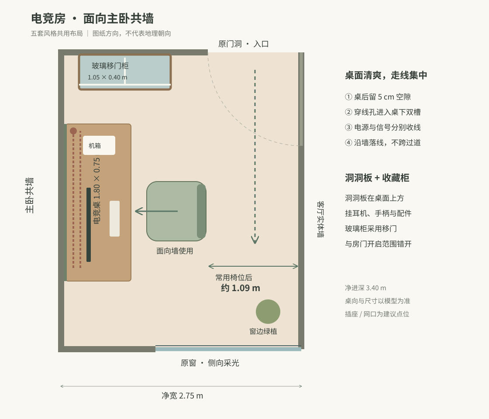

# 电竞房 · 五套风格统一布局

2026-10-21，按本轮要求将原书房兼客卧改为电竞与收藏空间。房间 ID `study` 保留，界面名称统一为「电竞房」。本说明取代旧文件中的窗下双人桌、上侧衣柜和临时客床方案。

## 摆放与通行

- 房间净尺寸仍为 **2.75 × 3.40 m**。图纸左侧是主卧共墙，右侧是客厅实体墙；上下左右仅对应户型图，不表示已确认地理朝向。
- **1.80 × 0.75 m 桌面**沿主卧共墙，桌高约 0.75 m，背后留 5 cm 理线空隙。坐下后面向共墙，原窗在身体侧面，入口在身后侧。
- 原临时客床与上侧衣柜取消。常用座椅占地按 0.68 × 0.68 m，椅背后至右侧墙约 **1.09 m**；后退 0.30 m 后余约 0.79 m。该数值以模型椅位计，实际椅型与使用位置会改变余量。
- 桌上方 **1.80 × 0.65 m 洞洞板**，底边约 1.505 m，避开显示器。挂耳机、手柄、小配件收纳篮；按设备调整挂件位置。
- 上侧墙放 **1.05 × 0.40 × 1.85 m 玻璃移门展示柜**，在原门洞左边，摆玩偶与小收藏。用玻璃层板和柔和层板灯，不占门扇扫掠区。柜与桌前后错开，正面可以站立取物。
- 单台约 34 英寸宽屏使用桌夹显示器臂；机箱在桌面靠入口端，保持进出风空间。主卧共墙不承托显示器臂，桌腿可加减振垫；没有把软装当作隔音工程。

## 走线

1. 显示器、键鼠及机箱线缆从桌面后沿穿线孔进入桌下。保留可拆束带与拔插余量。
2. 桌下两条可打开理线槽分别收电源线与信号线；插排固定在桌底靠入口端，可伸手检修。
3. 两路在桌侧靠墙分别下行至建议电源/网口点位，示意中心距地约 0.43 m；不用地面飞线跨越椅轮、门口或通道。模型以墙色线槽表示集中落线。
4. 插座、网口位置是本次设计预留，并非已核实的现场点位。落地时依据现有回路、设备功率和成品桌结构深化，电源与弱电使用独立路径，不凭效果图在主卧共墙开槽。
5. 柜内照明沿柜背收线，驱动与检修位置收在下部，避免让灯线垂在玻璃展示面。

## 各套风格

| 风格 | 材质与小物 |
| --- | --- |
| 奶白原木 | 浅橡木电竞桌、奶白背景、柔和灰绿布椅、浅木玻璃柜 |
| 林中树屋 | 原木桌面与墙面、深樱桃木柜和桌腿、苔绿座椅、窗边蕨类 |
| 现代日式中古 | 胡桃木与柚木、橄榄绿座椅、纸灯与中古台灯、克制的陶器 |
| 轻法式复古原木 | 浅木、象牙白洞洞板、灰蓝座椅、细黄铜把手与柔和线脚 |
| 日光花园原木 | 木边白台面、细条纹布椅、木色洞洞板、窗边成组绿植 |

植物集中在窗边，远离电脑和活动通道；洞洞板以配件收纳为主。各套保留原有全屋色彩，设备只用柔和背光与任务光。

## 文件与复核

- 尺寸与碰撞布局：`src/plan.ts` 的 `LAYOUT.gamingRoom` 与 `src/model.ts`；模型使用基础奶白原木材质，五套材质效果由全景表达。
- 全景：`public/panoramas/study.jpg` 及 `forest/japanese/french/sunlit/study.jpg`，各有 `study-thumb.jpg`。
- 生成使用内置 imagegen，提示词记录在 `home-design-review/logs/电竞房生成提示词.json`；以新模型全景为几何参考。
- 全景是材质与氛围示意，准确尺寸、桌向、门窗和通行以模型为准。实际五金、强弱电安装和产品散热需按选型细化。
