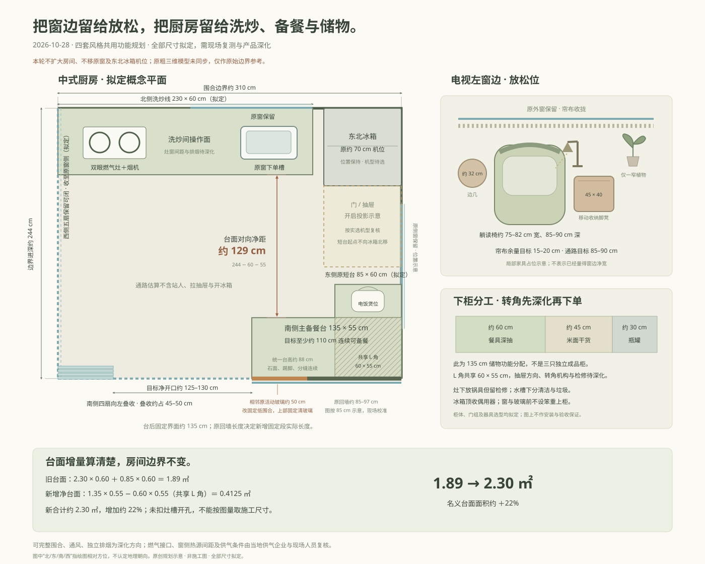

# 窗边放松区与中式厨房

2026-10-28。保留四套风格、七个房间和 360° 查看方式，调整客厅电视左窗边的使用方式与厨房的洗炒、备餐、储物关系。全景细节增强沿用现有 4× AI 超分流程；它不是原生高精度三维渲染，不能用于量取尺寸。

本页所有新增家具、柜体、门组与通路数值均为**拟定方案**。外窗、房屋边界与东北冰箱机位沿用；本轮不扩大房间。现有粗三维模型和 `plan.ts` 没有同步新家具、柜体与门组，只能查看原始尺寸与边界，不能据其判断本轮方案已经落地。



## 电视左窗边：从植物角变成能坐读、伸腿的放松位

电视、沙发和原外窗保持，腾出原植物角的大件占位，放入一把有背部与扶手承托的躺读椅。植物只保留一处窄点景，不再围住座位。

| 物件或空间 | 拟定尺度与用法 |
| --- | --- |
| 躺读椅 | 宽约 75–82 cm、深约 85–90 cm；以坐读和后靠放松为主，不按大型展开式躺椅预留 |
| 移动收纳脚凳 | 约 45 × 40 cm；用时移出承托双脚，平时收回靠椅；书、薄毯放入内部 |
| 边几 | 约 32 cm，承接杯子、手机及正在读的书；不兼作大件陈列台 |
| 阅读灯 | 定向照书页，落点和开关在座位顺手范围；不靠整屋泛黄提高“氛围” |
| 帘布余量 | 椅背与收拢帘布之间目标约 15–20 cm，另核窗扇开启与帘布完整行程 |
| 主通路 | 脚凳收回后目标约 85–90 cm；伸腿使用时的临时占位需用实物尺寸核对 |

上述数值需通过现场复测、座椅样板与实际坐姿验证；不是已量得的净距。窗边植物的盆体也计入占位。

## 厨房：保留取洗炒位置，把主备餐和储物接成 L

保留约 3.10 × 2.44 m 围合边界、原外窗及东北约 70 cm 冰箱机位。北侧拟定约 230 × 60 cm 洗炒线：双眼燃气灶与烟机落在原实墙段，原窗下保留单槽。灶、窗、烟机和燃气接口之间的真实间距，待器具选型与现场深化。

东侧原约 85 × 60 cm 短台不向冰箱加长，起点仍放在冰箱门及抽屉开启投影以外。它与新增南侧约 135 × 55 cm 低备餐柜连成 L，统一拟定约 88 cm 台高、连续石面、踢脚与抽屉分缝。南台替代对面孤立矮柜及笨重上柜；窗和玻璃前不加上柜。

南侧 135 cm 台面目标保留至少约 110 cm 连续备餐面。电饭煲放东侧短台，插座、蒸汽避让和开盖高度随产品深化，不再占据主切配面。北侧保留洗、炒，南侧集中切配与装盘。

### 下柜按活动分工，转角不重复计算

| 位置 | 拟定分配 |
| --- | --- |
| 南台约 60 cm | 餐具深抽，以常用碗盘为主 |
| 南台约 45 cm | 米面与干货，容器按实际存放数量选型 |
| 南台约 30 cm | 瓶罐，避免散放到主备餐面 |
| 灶下 | 锅具；保留燃气接口、阀件与检修所需可达空间 |
| 水槽下 | 清洁与垃圾分区，给排水和检修不被储物封堵 |
| 冰箱上方 | 偶用器具，散热和检修按实选冰箱核对 |

60 / 45 / 30 cm 是储物功能分配的拟定尺度，不表示三只标准独立抽屉都已获得开启条件。东、南两台有约 60 × 55 cm 共享 L 角；需结合转角柜、抽屉方向及机构重新排分缝、检修口和内部净尺寸，避免把同一空间算两遍。

### 台面和通路算式

均按名义尺寸估算，未扣水槽、灶具开孔，也未计端头收口及门框投影。

```text
原台面 = 2.30 × 0.60 + 0.85 × 0.60 = 1.89 ㎡
新增净台面 = 1.35 × 0.55 − 0.60 × 0.55 = 0.4125 ㎡
新台面 = 1.89 + 0.4125 = 2.3025 ㎡，约 2.30 ㎡
增加比例 = 0.4125 / 1.89 = 21.83%，约 22%
对向台面净距 = 2.44 − 0.60 − 0.55 = 1.29 m
围合边界面积 = 3.10 × 2.44 = 7.564 ㎡（含柜体投影）
```

1.29 m 是柜台面之间的几何净距估算，不包含人站立、抽屉打开、冰箱开门等使用占位，也不是全厨房每一点都同宽。

## 南侧围合调整：备餐台后固定，门组向左叠收

原南侧约 85–97 cm 回墙的边界关系保留；其相邻原活动玻璃约 50 cm 拟改为固定低围合，与回墙共同形成南侧约 135 cm 备餐台后的固定界面。台面以上使用固定清玻璃，保持采光和视线。原回墙的真实长度会影响新增固定段的准确长度；图中按 85 cm 原回墙加 50 cm 调整段示意，不能把两组约数直接当施工下单尺寸。

剩余南侧门组拟保留四扇，向左叠收，目标净开口约 125–130 cm。按 310 − 135 = 175 cm 门组跨度、叠收约占 45–50 cm 估算：

```text
南侧目标净开口 = 175 − (45～50) = 125～130 cm
```

西侧五扇保留可闭，南侧固定清玻璃、低围合和活动门共同形成可完整围合的厨房。门框、收门宽度、密封、承托及端部导向由实际门系统深化；本页不保证任何具体产品能按图直接安装或达到特定验收结果。

## 四套材料保持各自风格

| 风格 | 窗边放松位 | 厨房与餐边 |
| --- | --- | --- |
| 林中树屋 | 苔绿亚麻躺读椅、深樱桃木小件与定向灯 | 苔绿下柜、浅石色连续台面，樱桃木餐桌与咖啡柜延续 |
| 现代日式中古 | 橄榄绿软椅、胡桃木脚凳与小边几 | 胡桃木下柜、暖白连续石面，编织餐椅与陶器延续 |
| 轻法式复古原木 | 灰蓝软椅、浅木小件、克制黄铜细节 | 浅木细框柜门、象牙白连续石面，藤编与亚麻延续 |
| 日光花园原木 | 米白条纹软椅、浅木脚凳、一窄植物 | 白方砖、浅木下柜与白色连续台面，开放杯架留在餐边 |

餐边咖啡活动继续在原位置，燃气烹饪、主备餐、米面和锅具储物归入厨房。餐桌与厨房门边的路径不堆放小家电、凳子和盆栽。

## 现场深化与参考范围

本方案按可完整围合、通风、独立排烟的厨房方向深化。气源、燃气接口、器具选型、窗侧热源间距、烟道与补风、门组及固定低围合构造，最终由现场设计安装人员和当地供气企业结合本户型复核。未写品牌、未确认通气条件、未作验收保证。

- [住房城乡建设部：《住宅项目规范》GB 55038-2025 发布公告](https://www.mohurd.gov.cn/gongkai/zc/wjk/art/2025/art_66adac27fa2144bb86f98fe4c297efd6.html)：用于了解国家标准的发布背景。
- [常德市人民政府：开放式厨房是否能开通天然气，2025-05-15 地方回复](https://www.changde.gov.cn/zmhd/szxx/cjwt/content_78155959)：属于特定地区和答复时点的资料，不能据此推断用户所在地的现行受理条件。

这些链接不代替当地现行标准和供气企业的现场复核。本轮只更新写实 360° 设计及其规划说明，原尺寸模型继续保留作历史边界参考。
