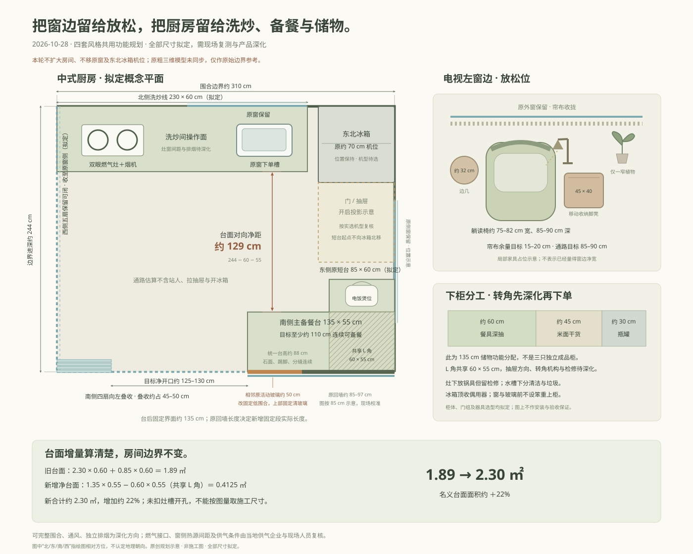
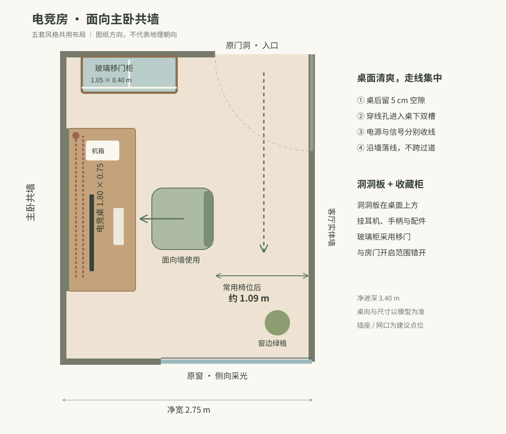

# 最新拟定方案：窗边放松区与中式厨房

2026-10-28。保留四套风格、七个房间及 360° 观看方式，本轮把电视左窗边改成能坐读、伸腿的放松位，并把中式厨房的洗炒、备餐与储物连成清楚的工作面。

**新增家具、柜体、门组和通路数值均为拟定，需现场复测和产品深化。现有粗三维模型未同步本轮方案，仅供查看原始尺寸与边界。** 本节取代下方历史记录中与本轮不同的植物角、厨房台面和南侧门组安排；历史记录的“已落实”仅指当时数字方案。

## 窗边放松区

- 电视、沙发及原外窗保持。电视左窗边拟放约 75–82 cm 宽、85–90 cm 深的躺读椅，配约 45 × 40 cm 移动收纳脚凳、约 32 cm 边几与定向阅读灯。
- 脚凳用时移出承托双脚，收回时靠椅，书和薄毯入凳。只留一处窄植物，不再把大盆栽围在座位旁。
- 椅背与收拢帘布之间目标约 15–20 cm；脚凳收回后主通路目标约 85–90 cm。窗扇开启、帘布行程、实际坐姿和家具净尺寸均待核对。

## 中式厨房

| 项目 | 本轮拟定安排 |
| --- | --- |
| 边界与冰箱 | 沿用约 3.10 × 2.44 m 围合边界、原窗和东北约 70 cm 冰箱机位，不扩大房间 |
| 北侧洗炒 | 约 230 cm 主台保留原窗下单槽，原实墙段放双眼燃气灶和烟机 |
| 连续 L 台 | 东侧原约 85 cm 短台不向冰箱加长，起点仍避开门及抽屉投影；接新增南侧约 135 × 55 cm 低柜，同拟定约 88 cm 台高，连续石面、踢脚及分缝 |
| 主备餐面 | 南台目标至少约 110 cm 连续可备餐；电饭煲放东短台，窗和玻璃前不增上柜 |
| 下柜储物 | 约 60 / 45 / 30 cm 拟分餐具深抽、米面干货、瓶罐；共享 L 角的机构与抽屉开启待深化，不能按三只独立成品柜下单 |
| 其他收纳 | 灶下锅具不封燃气检修；水槽下分清洁和垃圾；冰箱顶可放偶用器 |
| 南侧围合 | 相邻原活动玻璃约 50 cm 改固定低围合，与原约 85–97 cm 回墙共同形成南台后固定界面，上部固定清玻璃；准确长度随复测调整 |
| 门组 | 其余南侧四扇拟向左叠收，目标净开口约 125–130 cm；西侧五扇保留可闭 |

名义台面由 `2.30 × 0.60 + 0.85 × 0.60 = 1.89 ㎡`，增加 `1.35 × 0.55 − 0.60 × 0.55 = 0.4125 ㎡`，合计约 **2.30 ㎡，增加约 22%**。扣除的是共享 L 角，避免重复计算；未扣灶槽开孔。对向台面净距按 `2.44 − 0.60 − 0.55 = 1.29 m` 估算，不包含站人、开门和拉抽屉占位。

四套材料保持原风格：林中树屋为深樱桃木、苔绿与亚麻；日式中古为胡桃木、橄榄绿与暖白石面；轻法式为蜂蜜浅木、灰蓝与象牙白石面；日光花园为浅木、白台面和米白条纹。餐边咖啡活动留在原位置，燃气烹饪、主备餐和锅具米面归入厨房。

本方案按可完整围合、通风、独立排烟方向深化。器具选型、窗侧热源间距、燃气接口、门组构造及现场供气条件由当地供气企业和现场设计安装人员复核；未作通气、安装或验收保证。写实全景和 AI 细节增强不能用于反向量取施工尺寸。

---

以下为历史版本快照；其中旧厨房门组、植物角及模型同步状态不代表 2026-10-28 新方案。

# 历史归档：2026-10-21 电竞房调整

2026-10-21：原书房兼客卧改为电竞房。1.80 × 0.75 m 桌面沿主卧共墙摆放，面向墙、侧向采光；洞洞板挂耳机、手柄，1.05 × 0.40 m 玻璃移门柜展示玩偶。桌后留 5 cm、桌下电源与信号分槽，沿墙集中落线，常用椅位后约 1.09 m 通道。原临时客床取消，原门窗及客厅实体墙保留。五套全景与缩略图同步更新，基础尺寸模型同步更新。

该调整取代以下旧复核中“书房办公 / 留宿转换”的待定项，其他房间复核仍沿用。插座与网口为建议位置，按现有线路及设备选型深化。

---

# 历史归档：2026-10-20 MUJI 原木风复核

复核日期：2026-10-20。初评及上一轮全景验收归档保留，最新用户要求以本摘要和16报告为准。

本轮使用奶白墙、低黄低红的自然橡木与细直纹地面，弱化日间黄光偏色。材料底色色卡用于直接观察奶白底色，不能据此确定现场漆号。电视后保持完整实墙，厨房朝餐厅和玄关开放；不存在的两卧侧窗继续取消，餐厅与上方阳台总深仍为3.45m。

## 本轮布局

| 状态 | 整改 | 尺寸与证据 |
|---|---|---|
| 模型已落实 | 冰箱靠边整合 | 0.70×0.70m机位移至厨房上墙右端，加侧板与顶柜，退出原穿行区域；南向开门 |
| 模型已落实 | 冰箱开门避让 | 独立复核发现原拟1.50m右台会挡冷冻门，已缩为0.85m、起点退至z1.65m；示意门90°扫掠到z1.54m，保留约0.11m几何余量 |
| 模型已落实 | 灶、烟罩避开外窗 | 移至上墙左侧实墙段，罩右缘与上窗起点约相隔0.105m；原右窗重叠已避让，安装支承与烟道仍待核 |
| 模型已落实 | 餐厨一体与咖啡角 | 1.20×0.70m餐桌、左长凳右椅，右侧静态通路约0.92m；原洗衣位改1.50×0.48m咖啡餐边柜，集中咖啡机、磨豆机和杯具 |
| 模型已落实 | 洗衣机迁入卫浴 | 不扩大1.65×3.70m卫浴；机器0.60m宽、含前门总深约0.69m，位于台盆旁，共用1.48m台面，最窄通路约0.94m |
| 模型已落实 | 卫浴门与功能分区 | 约0.87m洞口右移、内开贴右墙，保留上端淋浴与中段马桶；成品净宽、洗衣开门与取衣需按产品复核 |
| 方案已调整 | 植物与材质 | TV左孟加拉榕、咖啡台咖啡树、餐窗垂叶绿萝，素色哑光盆器；减少零散盆栽和粗大重复木纹 |

厨房为紧凑的近一字型取洗切炒序列，灶槽间约0.58m净备餐段，右台补充操作。工作三角约0.73/1.17/1.90m、总长3.80m，未宣称达到整改文档传统三角筛查值；优先按实际小户型的连续操作和通行判断。

## 现场仍需确认

开放厨房内墙性质、当地用能条件、排烟补风与设备安装仍为P0待确认。洗衣迁移须核排水、防水、通风、电路和检修；洗衣机滚筒门打开取衣时会暂占共用通路。冰箱型号、散热及抽屉所需开角尚未选定，90°示意避让不等于任意冰箱都可直接安装。

既有客房床桌局部约0.21m、主卧两侧余量、真实朝向、采光与任务照明仍需深化；本轮没有因图片写实而关闭这些问题。

## 来源与验收口径

植物按[MUJI 官方选植建议](https://house.muji.com/life/clmn/tebiki/tebiki_260430/)选型；[RHS 观赏榕指导](https://www.rhs.org.uk/plants/ornamental-figs)强调温暖明亮、避免直接暴晒。电视角是否有合适生长光应现场判断，不能凭全景亮度确认。

按用户整改文档沿用已取得的A/B/C/D技能资料和十角色评估；下载与降级记录见原报告，不重复执行未知安装脚本。完整资料位于`home-design-review/output/`：00–12为原角色与问题清单，13–15为上一轮布局、全景和运行记录，16为本轮餐厨卫、材质、植物与尺寸独立复核，并补充本轮验收。

尺寸依据当前模型；AI生成360用于体验材质氛围，不能反向量取施工尺寸。所有已落实状态指数字方案，结构、水电、安装和当地规范均未据图验收。

本轮七张主图及七张缩略图已全部重新生成，逐图目视复核见16报告，未沿用上一轮的三房图片。奶白、细纹木、咖啡柜、冰箱靠边及卫浴洗衣均已表达；首轮发现的客厅透明门及主卧额外盆栽已定点修正，并直接复查最终图：客厅为乳白不透明八格，主卧镜下层板清空。其他节点门格、柜体曲面和窗外背景仍有生成偏差，产品构造和准确尺寸以模型与选品为准。导览新增“查看材质本色”，桌面侧栏和手机工具条都能打开四块大样片，避开场景灯光看底色。
